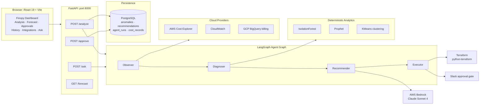
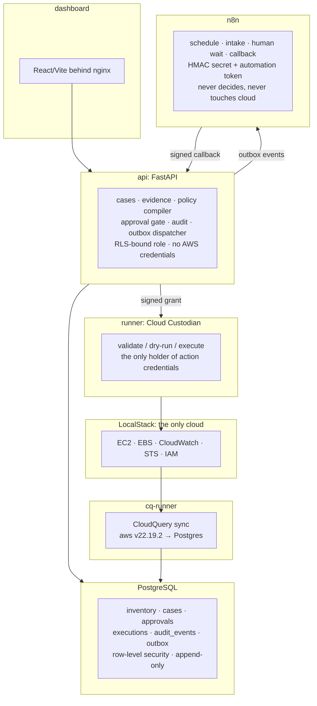
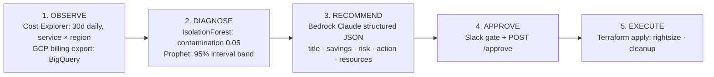
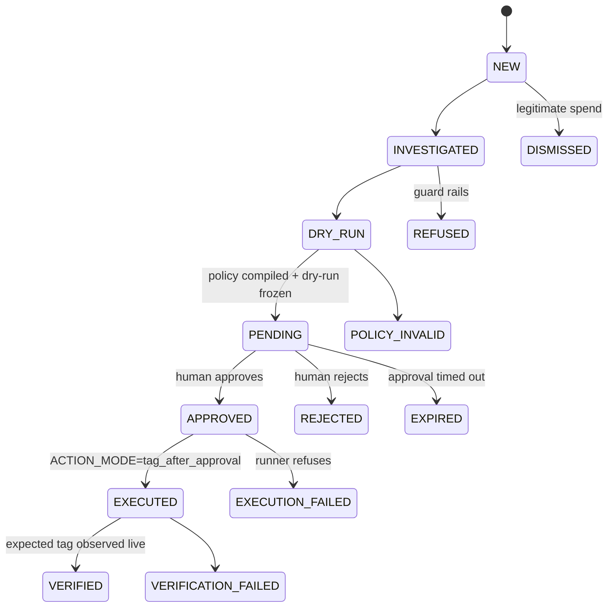

# Finopy

AI-powered multi-agent cloud cost optimizer. Finopy watches AWS/GCP billing, detects spend anomalies with ML, explains them in plain language, and proposes cost-saving actions for optional execution behind a human approval gate.

This repository also ships **FinOps Sentinel** (`sentinel/`), a deterministic, tenant-isolated remediation pipeline for LocalStack.

**Author:** Bhargav

**Stack:** LangGraph, FastAPI, Prophet/scikit-learn, React 19 + Vite, PostgreSQL, n8n, LocalStack, Cloud Custodian

## Table of Contents

1. [Executive Summary](#1-executive-summary)
2. [System Architecture](#2-system-architecture)
3. [Core Workflow](#3-core-workflow)
4. [API Reference](#4-api-reference)
5. [Module Map](#5-module-map)
6. [Tech Stack Rationale](#6-tech-stack-rationale)
7. [Data Model](#7-data-model)
8. [Local Setup](#8-local-setup)
9. [Testing](#9-testing)
10. [Deployment](#10-deployment)
11. [Production Hardening](#11-production-hardening)
12. [Trade-offs and Known Limits](#12-trade-offs-and-known-limits)
13. [Project Layout](#13-project-layout)

## 1. Executive Summary

### What it does

A LangGraph agent graph runs an Observe → Diagnose → Recommend → Execute cycle over cloud billing. It ingests 30 days of AWS Cost Explorer data (or GCP BigQuery billing export), flags anomalies with IsolationForest and Prophet, asks Claude for structured savings recommendations, and executes approved recommendations through Terraform. High-risk changes pass through a Slack approval gate.

### Why it is interesting

There are two systems in one repository, with different operating philosophies. Finopy is LLM-driven and exploratory, suited to questions such as “Why did my bill spike?” Sentinel (`sentinel/`) is fully deterministic: no LLM is in its money path. It uses multi-tenant row-level security, a compare-and-set case state machine, and HMAC-signed approval callbacks. The AI can suggest; the math and audit trail do not depend on AI output.

### What is grounded

- Every anomaly carries `expected_cost`, `actual_cost`, and `deviation_pct`, computed by pure functions.
- Every recommendation carries `estimated_savings_monthly` and a `risk_level`.
- Severity thresholds are deterministic constants: ≥100% deviation is critical, ≥50% is high, and ≥25% is medium.

### What works first-try

No AWS keys are required for the demo. Demo mode serves deterministic fixture data. Copy `.env.example` to `.env`, start `uvicorn api.main:app`, and open the dashboard.

## 2. System Architecture

### 2.1 Finopy: LLM-driven agent app



### 2.2 FinOps Sentinel: deterministic hardened pipeline



### 2.3 Two brains, one repository

| System | Brain and pipeline | LLM in the money path? |
|---|---|---|
| Finopy | LangGraph: observe → diagnose → recommend → execute; Cost Explorer → IsolationForest/Prophet → Bedrock Claude → Terraform | Yes. Claude writes recommendations. |
| Sentinel | Deterministic LangGraph: ingest → baseline → detect → attribute → assess → recommend; CloudQuery → median/MAD baseline → rules → policy compiler | No. Money uses `Decimal`; scores come from a weekday-seasonal baseline; owners come only from reference data. |

Finopy is the exploratory assistant for natural-language investigation. Sentinel is the auditable operator: state transitions use compare-and-set, approvals re-verify policy and target digests, and the executor re-reads live resources before acting.

## 3. Core Workflow

### 3.1 Finopy analysis cycle



1. **Observe:** The Observer pulls 30 days of daily cost data grouped by service and region (`GetCostAndUsage`), plus EC2 utilization from CloudWatch.
2. **Diagnose:** Both detectors run on every `(service, region)` series. Results are unioned, deduplicated, and sorted from critical to low. Expected cost is the group median for IsolationForest or Prophet's `yhat`.
3. **Recommend:** Claude receives anomalies and cost totals, then returns structured JSON recommendations. Each includes a monthly savings estimate and risk level. Supported action types include `rightsize`, `terminate`, `reserve`, `schedule`, and `migrate`.
4. **Approve:** High-risk actions use the Slack approval gate. Recommendations can also be approved or rejected through `POST /approve` or the dashboard.
5. **Execute:** Approved actions with a Terraform plan run `terraform init`, `plan`, and `apply` through `python-terraform`. Results and savings are recorded.

### 3.2 Sentinel case lifecycle

Every cost case is a state machine with compare-and-set transitions. Each transition writes an audit event and an outbox notification in the same transaction.



In the default `alert_only` mode, `APPROVED` is terminal: a human fixes the waste and the system never touches the cloud. Only `tag_after_approval` proceeds to execution and verification. Even then, the runner re-reads live resources, reruns the dry-run, and requires an exact target match before acting.

## 4. API Reference

### 4.1 Finopy API

`api/main.py` provides the FastAPI application on port 8000. Every endpoint is demo-aware: if `FINOPS_AWS_ACCESS_KEY_ID` is unset, handlers serve deterministic fixtures and do not contact AWS, the LLM, or the database.

| Method | Path | Purpose |
|---|---|---|
| `GET` | `/health` | Liveness and readiness: version, agents ready, cloud connected, timestamp. |
| `POST` | `/analyze` | Run the LangGraph cycle; persist an agent run, anomalies, and recommendations; return the report. |
| `POST` | `/ask` | Conversational Q&A. Returns `answer`, `sources[]`, and `follow_up_suggestions[]`. |
| `POST` | `/approve` | Approve or reject `{recommendation_id, approved, reason?}`; returns queued or rejected status. |
| `GET` | `/recommendations?pending_only=false` | List the latest 50 recommendations, newest first; optionally filter unapproved. |
| `GET` | `/forecast?horizon_days=30` | Prophet forecast: projected total, confidence interval, and daily average. |
| `GET` | `/history/runs?limit=20` | Agent run history: status, anomalies, recommendations, and identified savings. |
| `GET` | `/integrations` | Integration catalog for AWS, GCP, Azure, Slack, Email, Jira, and Telegram. |

Example analysis request:

```json
{
  "query": "Why did my EC2 bill spike last week?"
}
```

Example response:

```json
{
  "report": "# FinOps Analysis Report\n...",
  "anomalies_count": 4,
  "recommendations_count": 5,
  "total_potential_savings": 3138.0,
  "anomalies": [
    {
      "service": "AmazonEC2",
      "region": "us-east-1",
      "expected_cost": 2450.0,
      "actual_cost": 4120.5,
      "deviation_pct": 68.2,
      "severity": "critical"
    }
  ],
  "recommendations": [
    {
      "id": "demo-terminate-idle-ec2",
      "title": "Terminate idle EC2 instances",
      "estimated_savings_monthly": 432.0,
      "risk_level": "medium",
      "action_type": "terminate"
    }
  ]
}
```

Example approval request and response:

```json
// POST /approve
{
  "recommendation_id": "demo-rightsize-rds",
  "approved": true
}
```

```json
{
  "recommendation_id": "demo-rightsize-rds",
  "approved": true,
  "status": "queued_for_execution"
}
```

### 4.2 Sentinel API

`sentinel/api/app/` provides a FastAPI service on port 8000 with bearer-token authentication and tenant scope enforced through PostgreSQL RLS.

| Method | Path | Purpose |
|---|---|---|
| `GET` | `/health` | API, DB, runner, and worker liveness; outbox/execution counts and action mode. Returns 503 if unhealthy. |
| `GET` | `/me` | Current principal identity. |
| `GET` | `/cases` | List tenant-scoped cases. |
| `GET` | `/cases/{case_id}` | Case detail and timeline. |
| `GET` | `/cases/{case_id}/audit` | Case audit trail. |
| `GET` | `/audit/export` | Tenant audit export as NDJSON. |
| `GET` | `/series` | Time-series read model. |
| `GET` | `/overview` | Dashboard read model: totals, savings by workload/owner, 45-day spend, pending approvals, recent audit events. |
| `GET`, `PUT` | `/settings` | Workspace notification preferences; reviewer role, strict schema, audited. |
| `GET` | `/integrations` | Connector catalog with live status. |
| `PUT` | `/integrations/{provider}/interest` | Register or withdraw interest in a planned connector. |
| `POST` | `/analyze` | Human-triggered analysis. |
| `POST` | `/internal/analyze` | Automation-triggered analysis for n8n. |
| `POST` | `/cases/{case_id}/dry-run` | Compile, validate, dry-run, freeze, and request approval. |
| `GET` | `/approvals/{approval_id}` | Approval packet. |
| `POST` | `/approvals/{approval_id}/form-url` | Publish the local approval-form link. |
| `POST` | `/approve` | HMAC-signed approval callback; re-verifies actor role/PIN, case version, policy and target digests, expiry, and idempotency. |
| `GET`, `PUT` | `/internal/events/{event_id}` | n8n delivery deduplication: check before delivery and mark after success. |

### 4.3 Sentinel runner

`sentinel/runner/server.py` is an internal FastAPI service on port 8080 and is never published to the host. It is the only container holding (dummy) action credentials. Mutating routes require HMAC-SHA256 over `{timestamp}.{raw_body}` using `x-sentinel-timestamp` and `x-sentinel-signature`, with a maximum 300-second freshness window.

| Method | Path | Purpose |
|---|---|---|
| `GET` | `/health` | Runner liveness, Custodian version, and region; unauthenticated. |
| `POST` | `/validate` | Validate Custodian policy YAML after allow-list check. |
| `POST` | `/dryrun` | Run `custodian run --dryrun`; returns 422 if allow-list validation fails. |
| `POST` | `/inspect` | Read-only live inspection of EC2 instances and EBS volumes through boto3. |
| `POST` | `/execute` | Requires `ACTION_MODE=tag_after_approval`; rechecks allow-list, digests, expiry, target cap (hard cap 5), live tenant/protection/production tags, exact dry-run targets, and at-most-once marker before a real Custodian run. |

## 5. Module Map

### Top-level Finopy app

```text
agents/
├── supervisor.py        # LangGraph: observe → diagnose → recommend → execute → report
├── observer.py          # Pulls 30d Cost Explorer data (SERVICE × REGION)
├── diagnoser.py         # IsolationForest + Prophet; unions and deduplicates anomalies
├── recommender.py       # Bedrock Claude → structured JSON recommendations
├── executor.py          # Slack gate for high-risk; Terraform apply for approved actions
├── conversational.py    # Intent-based Q&A context builder (currently unused by API)
└── state.py             # FinOpsState, CostAnomaly, Recommendation TypedDicts

analytics/
├── anomaly.py           # IsolationForest/Prophet detectors and severity classifier
├── forecast.py          # Monthly and per-service Prophet forecasts
└── clustering.py        # KMeans cost-behavior profiles and optimization hints

cloud/
├── aws/
│   ├── cost_explorer.py # GetCostAndUsage + GetRightsizingRecommendation
│   ├── cloudwatch.py    # GetMetricStatistics → idle/oversized CPU flags
│   └── ec2_advisor.py   # Idle EC2, oversized instances, unattached EBS/EIPs
└── gcp/
    └── billing.py       # BigQuery export normalized to AWS-shaped records

api/
├── main.py              # FastAPI routes
├── schemas.py           # Pydantic models and enums
├── models.py            # SQLAlchemy ORM models
└── demo_data.py         # Deterministic demo fixtures

iac/
├── actions.py           # Terraform init → plan → apply wrapper
└── terraform/           # Right-sizing, cleanup, and ECS templates

notifications/
├── slack.py             # Webhook messages and approval gate
└── email.py             # SMTP anomaly alerts and weekly reports

dashboard/               # React 19 + Vite + Recharts UI
config/settings.py       # pydantic-settings, FINOPS_ prefix
scheduler.py             # Daily analysis and weekly report coroutines
```

### Sentinel subsystem (`sentinel/`)

```text
sentinel/
├── api/app/             # FastAPI: cases, approvals, policy compiler, state machine, outbox
│   ├── graph.py         # Deterministic LangGraph analysis pipeline
│   ├── states.py        # Compare-and-set state machine and audit per transition
│   └── tests/           # Logic, briefing, settings, stack, summarize, budget
├── runner/server.py     # Isolated Cloud Custodian runner (HMAC-guarded)
├── cq/                  # CloudQuery sync wrapper (inventory → Postgres)
├── n8n/                 # Workflow builder and generated workflows
├── db/migrations/       # Core, seen-events, settings/integrations migrations
├── seed/                # Deterministic LocalStack healthy/problem profiles
├── dashboard/           # React/Vite UI behind nginx
├── scripts/             # E2E, status/audit, demo, and run scripts
├── docs/                # Architecture, demo, and audit verification
└── docker-compose.yml   # Full LocalStack stack
```

## 6. Tech Stack Rationale

| Layer | Choice | Why |
|---|---|---|
| Agent orchestration | LangGraph `StateGraph` | Conditional edges model the FinOps cycle; the same graph library powers Sentinel's deterministic pipeline. |
| LLM | AWS Bedrock, Claude Sonnet 4 | Data stays in the AWS account. `FINOPS_LLM_PROVIDER` also offers OpenAI/Azure options through the same call site. |
| Anomaly detection | IsolationForest + Prophet | IsolationForest needs no labels and catches point spikes; Prophet catches trend/band violations. Running both and unioning results broadens coverage. |
| Forecasting | Prophet | Weekly/yearly seasonality and confidence intervals are available out of the box. |
| Cloud SDKs | boto3, google-cloud-bigquery | Cost Explorer, rightsizing, and CloudWatch cover common FinOps data needs without instance agents. |
| IaC execution | python-terraform | Terraform plan output is the safety artifact; the executor dry-runs before apply. |
| API | FastAPI | Async support, Pydantic validation, and automatic OpenAPI docs. |
| Database | PostgreSQL + SQLAlchemy | Sentinel needs row-level security, advisory locks, and append-only triggers. |
| Automation | n8n | Scheduling, human waits, and Slack callbacks are workflow problems. |
| Dashboard | React 19 + Vite + Recharts | Routing, charts, and chat UI; replaces the old Streamlit prototype. |

### Why deterministic for Sentinel

| Criterion | Finopy | Sentinel |
|---|---|---|
| Recommendation source | Claude-generated JSON | Median/MAD baseline + policy templates |
| Money math | Floats in prompts | `Decimal` throughout |
| Failure mode | Hallucinated figures | Wrong baseline, visible in audit |
| Approval evidence | Slack message | Policy digest + target digest re-verified at callback |
| Best for | Exploration and Q&A | Unattended operation with an audit trail |

Sentinel uses PostgreSQL advisory locks instead of Redis for per-tenant/window locking: `pg_try_advisory_xact_lock`, plus unique constraints on `(tenant, window, snapshot)` and `(tenant, idempotency_key)`. The lock and protected data share a transaction, avoiding split-brain between cache and database.

## 7. Data Model

### 7.1 Finopy

SQLAlchemy models map to PostgreSQL; SQLite is the default local database.

| Table | Purpose | Key fields |
|---|---|---|
| `cost_records` | Daily cost by service and region. Currently has no writer. | `date`, `service`, `region`, `cost`, `provider` |
| `anomalies` | Anomalies written by `POST /analyze`. | `service`, `region`, `expected_cost`, `actual_cost`, `deviation_pct`, `severity`, `detection_method`, `resolved` |
| `recommendations` | Recommendations written by analysis and updated by approval. | `title`, `estimated_savings_monthly`, `risk_level`, `action_type`, `resource_ids`, `terraform_plan`, approval/execution fields |
| `agent_runs` | Analysis runs written by `POST /analyze` and `scheduler.py`. | `trigger`, `user_query`, anomaly/recommendation counts, savings, `report`, `status` |

### 7.2 Sentinel

PostgreSQL schema and migrations live in `sentinel/db/migrations/001–003`. Every tenant-owned table has RLS through the `app.tenant_id` GUC. `sentinel_app` has no `DELETE`/`TRUNCATE` privileges; append-only tables have mutation-blocking triggers.

| Table | Purpose and invariants |
|---|---|
| `cases` | One row per detected waste case; unique `(case_id, tenant_id)` and `(tenant_id, dedupe_key)`. |
| `case_versions` | Immutable per-version case snapshots with content SHA-256. |
| `approvals` | At most one live approval per case; stores policy and target-set digests. |
| `executions` | Unique `approval_id` enforces one execution per approval. |
| `audit_events` | Append-only event log, exportable as NDJSON. |
| `outbox` | Event committed in the same transaction as the case transition. |

Supporting tables include `tenants`, `principals`, `owners`, `account_map`, `deployments`, `naming_rules`, `known_events`, `cost_facts`, `utilization_facts`, `inventory_snapshots`, `inventory_resources`, `analysis_runs`, `evidence`, `policies`, `idempotency_keys`, `n8n_seen_events`, `tenant_settings`, and `integration_interest`.

## 8. Local Setup

Prerequisites: Python 3.12+, Node.js 18+, and Docker (for PostgreSQL/Redis/LocalStack).

```bash
# 1. Clone
git clone https://github.com/Quick-Genius/Finopy.git
cd Finopy

# 2. Configure; leave AWS keys empty for demo mode
cp .env.example .env

# 3. Python environment
python -m venv .venv && source .venv/bin/activate
pip install -r requirements.txt

# 4. Start PostgreSQL and Redis
docker compose up -d postgres redis

# 5. Migrate
alembic upgrade head

# 6. Start the API (port 8000)
uvicorn api.main:app --reload

# 7. Start the dashboard in a separate terminal
cd dashboard && npm install && npm run dev

# 8. Trigger an analysis cycle
curl -X POST http://localhost:8000/analyze \
  -H 'Content-Type: application/json' \
  -d '{"query":"Daily cost analysis"}'
```

### Environment variables

All Finopy variables use the `FINOPS_` prefix. See `.env.example`.

| Variable | Default | Purpose |
|---|---|---|
| `FINOPS_AWS_REGION` | `us-east-1` | boto3 region. |
| `FINOPS_AWS_ACCESS_KEY_ID`, `FINOPS_AWS_SECRET_ACCESS_KEY` | Empty | AWS credentials; empty enables demo mode. |
| `FINOPS_GCP_PROJECT_ID`, `FINOPS_GCP_BILLING_ACCOUNT_ID` | Empty | GCP billing export. |
| `FINOPS_LLM_PROVIDER` | `bedrock` | `bedrock`, `openai`, or `azure`. |
| `FINOPS_BEDROCK_MODEL_ID` | `anthropic.claude-sonnet-4-20250514` | Recommendation model. |
| `FINOPS_OPENAI_API_KEY` | Empty | Used with the OpenAI provider. |
| `FINOPS_DATABASE_URL` | `sqlite:///finops.db` | SQLAlchemy URL; Compose uses PostgreSQL. |
| `FINOPS_REDIS_URL` | `redis://localhost:6379/0` | Agent state cache. |
| `FINOPS_SLACK_WEBHOOK_URL`, `FINOPS_SLACK_APPROVAL_CHANNEL` | Empty, `#finops-approvals` | Notifications and approval gate. |
| `FINOPS_APPROVAL_REQUIRED` | `true` | Require approval. |
| `FINOPS_MAX_AUTO_SAVINGS_THRESHOLD` | `100.0` | Auto-approval threshold in dollars/month. |
| `FINOPS_ANOMALY_SENSITIVITY` | `0.95` | Detection sensitivity. |
| `FINOPS_LANGSMITH_API_KEY` | Empty | Agent tracing. |

### Sentinel stack

```bash
cd sentinel
docker compose up -d
./scripts/demo.sh
```

Seed profiles are `healthy` (no waste) and `problem` (idle EC2, unattached EBS, and overspend). Use `./scripts/run-healthy.sh` or `./scripts/run-problem.sh`. The dashboard is on host port 3000, PostgreSQL on 5433, and LocalStack on 4566.

## 9. Testing

```bash
# Top-level Finopy tests
pytest -v
pytest --cov=agents --cov=analytics --cov=api -v

# Sentinel tests
cd sentinel/api && pytest -v
```

The documented suite has 88 tests: 24 top-level and 64 Sentinel. Tests do not call an LLM or real cloud; analytics uses synthetic series, cloud tests mock boto3, and API tests use fixtures.

| Test file | Count | Coverage |
|---|---:|---|
| `tests/test_anomaly.py` | 3 | Injected EC2 spike, severity thresholds (≥100/50/25), stable series. |
| `tests/test_forecast.py` | 3 | Projected total, confidence interval, daily average, trend, per-service forecast. |
| `tests/test_clustering.py` | 3 | Distinct patterns, graceful handling of fewer than 3 workloads, optimization hints. |
| `tests/test_cloud.py` | 4 | Cost Explorer normalization, rightsizing, CloudWatch stats, unattached EBS. |
| `tests/test_agents.py` | 5 | Graph compilation and transitions, empty data, clean diagnosis, savings totals. |
| `tests/test_api.py` | 6 | Health, analysis, validation, Q&A, unknown approval, forecast without data. |
| `sentinel/api/tests/test_logic.py` | 21 | Detection, attribution, policy rules, HMAC replay windows, state transitions. |
| `sentinel/api/tests/test_briefing.py` | 8 | Slack markup safety, fixed chart scales, alert-only messaging. |
| `sentinel/api/tests/test_settings_overview.py` | 12 | Strict settings, notification muting, overview read models. |
| `sentinel/api/tests/test_stack.py` | 12 | Stack-level behavior. |
| `sentinel/api/tests/test_summarize.py` | 7 | Case summarization. |
| `sentinel/api/tests/test_budget.py` | 4 | Budget alert rules. |

## 10. Deployment

### Finopy with Docker Compose

```bash
docker compose up -d --build
```

The API is on port 8000, PostgreSQL on 5432, and Redis on 6379. For AWS, `iac/terraform/deploy_ecs.tf` provides an ECS Fargate module:

```bash
cd iac/terraform
terraform init
terraform plan -var="vpc_id=vpc-xxx" -var='subnet_ids=["subnet-xxx"]'
terraform apply
```

Additional deployment options include EventBridge for scheduled observation, SQS for asynchronous agent messaging, S3 for reports, Secrets Manager for API keys, and LangSmith for tracing.

### Sentinel

```bash
cd sentinel
docker compose up -d
```

The runner is not published to the host. Only the API (8000), dashboard (3000), PostgreSQL (5433), and LocalStack (4566) are reachable.

## 11. Production Hardening

| Area | Status | Next step |
|---|---|---|
| Finopy API auth | Missing; CORS is `*` | Add API keys or OAuth. Sentinel's bearer-token + RLS model is a reference. |
| Persistent DB | Partial; SQLite is default, Compose uses PostgreSQL | Make PostgreSQL the default and add backup/restore runbook. |
| Approval gate | Slack stub auto-approves non-high risk after posting | Replace with Block Kit buttons and a signed callback; Sentinel `/approve` is a hardened reference. |
| Email alerts | Not connected; scheduler reads settings that do not exist | Add recipient settings or wire recipients explicitly. |
| Streaming | `/analyze` blocks until the cycle completes | Stream agent-phase events (SSE) for progressive dashboard updates. |
| Cost ingestion | `cost_records` has no writer | Add scheduled Cost Explorer → `cost_records` ingestion; Sentinel CloudQuery sync is a model. |
| Multi-model evaluation | Missing | Compare Bedrock/OpenAI/local recommenders for savings precision. |
| Audit chaining | Sentinel audit events are not hash-chained | Add a hash-chained log for tamper evidence. |
| Rate limiting | Missing | Throttle `/analyze` and `/ask` to control LLM costs. |
| Dashboard auth | Missing | Gate the React UI; tenant picker backed by Sentinel principals. |

## 12. Trade-offs and Known Limits

- **Root Compose dashboard service is stale.** It runs `streamlit run dashboard/app.py` on port 8501, but `dashboard/app.py` no longer exists. The dashboard is React/Vite; run it with `npm run dev` as described above until Compose is updated.
- **No auth on the Finopy API.** Anyone who can reach port 8000 can trigger analysis and approve recommendations. Do not expose it publicly as-is; Sentinel's token + RLS auth is the hardened path.
- **Slack approval is a stub.** It posts a message, then returns `risk_level != "high"`; low/medium actions are auto-approved and high-risk actions are blocked. A real gate needs interactive buttons and a signed callback.
- **Email alerts are wired to nothing.** `scheduler.py` reads `alert_email_recipients` and `report_email_recipients` with `getattr` defaults, but these fields do not exist in settings, so the email paths do not fire.
- **Demo mode is fixtures, not a simulation.** `/ask` returns the same canned answer regardless of query; `/history/runs` uses random data; approvals live in an in-memory dictionary and are lost on restart.
- **Some code paths are unused.** `agents/conversational.py` is not called by the API, `/ask` runs the agent cycle instead, `analytics/clustering.py` has no caller outside tests, `cost_records` has no writer, and `AnalysisConfig` is imported but unused. These remain as building blocks.
- **Sentinel is LocalStack-only by design.** Cloud credentials are dummy; the cloud is a local container. It demonstrates the pipeline and safety machinery, not real-cloud remediation.
- **Anomaly coverage is test-count-style, not assertion-based.** Deviating spend is classified as anomalous without proving the underlying metric is waste rather than legitimate growth. Sentinel's `known_events` table supports legitimate-growth cases.
- **Provider switching is not one line.** The LLM call site is Bedrock-first; OpenAI/Azure are config options, but Bedrock message formatting is baked into recommender prompts.

## 13. Project Layout

```text
Finopy/
├── README.md
├── requirements.txt
├── Dockerfile
├── docker-compose.yml       # API :8000, PostgreSQL :5432, Redis :6379; dashboard service is stale
├── alembic.ini
├── alembic/versions/        # Initial schema
├── .env.example
├── scheduler.py             # Daily analysis + weekly reports
├── agents/                  # LangGraph agents
├── analytics/               # Anomaly detection, forecasting, clustering
├── api/                     # FastAPI, schemas, ORM models, demo fixtures
├── cloud/                   # AWS and GCP integrations
├── iac/                     # Terraform execution wrapper and templates
├── notifications/           # Slack and email
├── config/settings.py       # pydantic-settings (FINOPS_ prefix)
├── dashboard/               # React 19 + Vite application
│   └── src/                  # App, API client, pages, styles
├── tests/                   # Finopy tests
└── sentinel/                # Deterministic hardened pipeline
    ├── api/app/              # Cases, approvals, policy compiler, state machine
    ├── runner/server.py      # Isolated HMAC-guarded Cloud Custodian runner
    ├── cq/                   # CloudQuery sync wrapper
    ├── n8n/                  # Workflow builder and generated workflows
    ├── db/migrations/        # Core, seen events, settings/integrations
    ├── seed/                 # LocalStack healthy/problem demo profiles
    ├── dashboard/            # React/Vite UI behind nginx
    ├── scripts/              # E2E, audit, demo, and run scripts
    ├── docs/                 # Architecture, demo, audit verification
    └── docker-compose.yml    # Full LocalStack stack
```